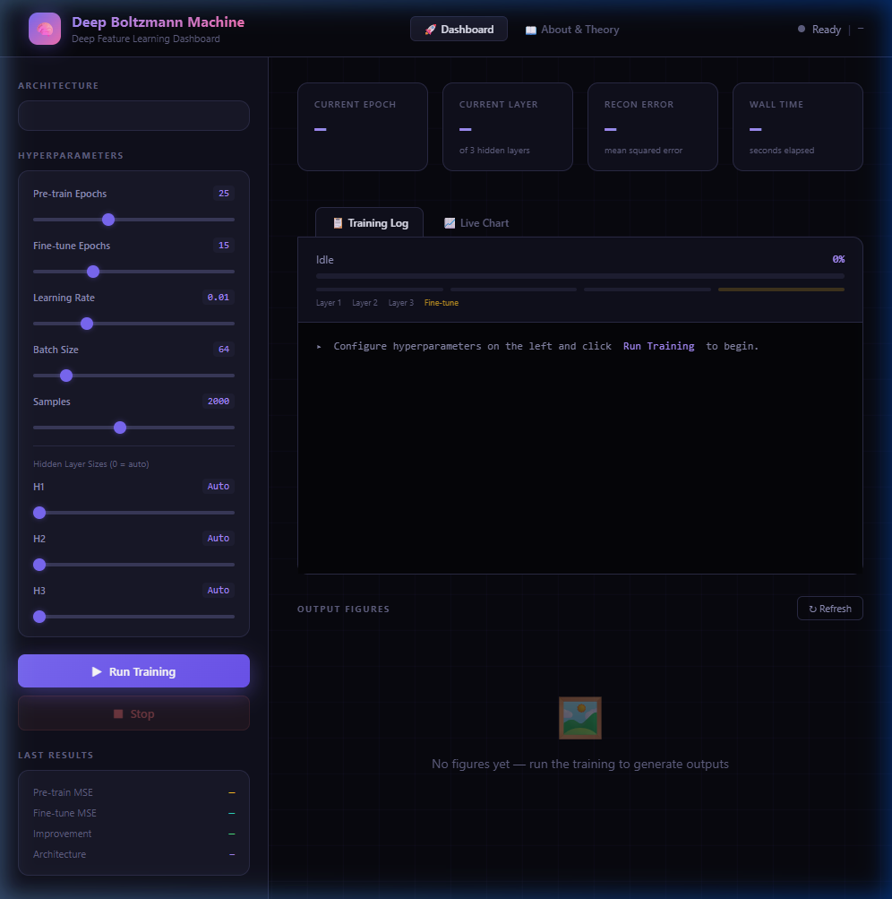

# Deep Boltzmann Machine (DBM) — Feature Learning & Interactive Analytics Dashboard

[](https://www.python.org/)
[](https://flask.palletsprojects.com/)
[](LICENSE)
[](https://en.wikipedia.org/wiki/Boltzmann_machine)

An end-to-end implementation of a **Deep Boltzmann Machine (DBM)** with greedy layer-wise Restricted Boltzmann Machine (RBM) pre-training, Gibbs sampling, and an **interactive, modern web dashboard** for real-time monitoring, live training execution, and visual analytics.

---

## 📸 Interactive Web Dashboard Preview

The project comes with a built-in Flask web application providing a dark-mode glassmorphic control center to launch training, stream execution logs in real-time, inspect mathematical derivations, and interact with all output figures.

### Dashboard Overview & Control Center


### Real-time Training Execution & Live Streaming Logs


### Model Theory, Architecture & Mathematical Derivations Panel


---

## 🌟 Key Features

- **Full Deep Energy-Based Architecture**: 2-layer Deep Boltzmann Machine ($v \leftrightarrow h_1 \leftrightarrow h_2$) with undirected symmetric bipartite connections.
- **Greedy Layer-Wise Pretraining**: Pre-trains lower and upper layers using Contrastive Divergence ($CD_k$) / Persistent Contrastive Divergence ($PCD$) before joint training.
- **Gibbs Sampling & Reconstructions**: Fast stochastic alternating Gibbs sampling for fantasy generative dreaming and visible reconstruction.
- **Interactive Web Dashboard**: Built with a dark glassmorphism UI, real-time training controls, architecture inspection, mathematical theory breakdown, and dynamic visual gallery.
- **Robust Dataset Pipeline**: 3-tier fallback data loader (Torchvision MNIST $\rightarrow$ Scikit-Learn OpenML $\rightarrow$ Synthetic High-Entropy digits) ensuring zero crashes across any environment.
- **Rich Visual Analytics**: Generates weight receptive field filters, t-SNE feature cluster embeddings, hidden layer activation heatmaps, and reconstruction quality comparisons.

---

## 🧠 Model Architecture & Mathematical Theory

A Deep Boltzmann Machine is an undirected probabilistic graphical model composed of multiple layers of stochastic binary units. Unlike Deep Belief Networks (DBNs) which are directed, DBMs have undirected connections between all adjacent layers:

```text
    [ Layer 2: Hidden Units (h2) ]    (e.g., 64 units)
                 ▲ ▼  W2
    [ Layer 1: Hidden Units (h1) ]    (e.g., 256 units)
                 ▲ ▼  W1
    [ Layer 0: Visible Units (v) ]    (e.g., 784 units: 28x28 pixels)
```

### 1. Energy Function
$$E(v, h_1, h_2) = - v^T W_1 h_1 - h_1^T W_2 h_2 - b^T v - c_1^T h_1 - c_2^T h_2$$

Where:
- $v \in \{0, 1\}^D$: Visible input vector
- $h_1 \in \{0, 1\}^{H_1}$, $h_2 \in \{0, 1\}^{H_2}$: Hidden representation vectors
- $W_1, W_2$: Weight matrices connecting adjacent layers
- $b, c_1, c_2$: Bias terms for visible and hidden layers

### 2. Conditional Distributions (Mean-Field Inference)
Because layers only interact with adjacent layers (bipartite independence):
$$P(h_{1j} = 1 \mid v, h_2) = \sigma\left( \sum_i v_i W_{1, ij} + \sum_k W_{2, jk} h_{2k} + c_{1j} \right)$$
$$P(h_{2k} = 1 \mid h_1) = \sigma\left( \sum_j h_{1j} W_{2, jk} + c_{2k} \right)$$
$$P(v_i = 1 \mid h_1) = \sigma\left( \sum_j W_{1, ij} h_{1j} + b_i \right)$$

---

## 📊 Experimental Results & Visualizations

The training process generates 7 publication-grade diagnostic visualizations:

### 1. Input Dataset Samples
Sample binarized digit inputs normalized to $28 \times 28$ grayscale pixels:


### 2. Training Reconstruction Error Curves
Shows convergence curves during layer-wise pretraining (RBM1, RBM2) and joint DBM training:


### 3. Learned Weight Filters (Receptive Fields)
First-layer weights $W_1$ visualized as $28 \times 28$ feature detectors. Notice the learned stroke, edge, and loop detectors:


### 4. Input vs. Reconstructed Images
Comparison between original test digits and their reconstructions through Gibbs sampling ($v \to h_1 \to v'$):


### 5. Hidden Layer Activation Heatmaps
Activation sparsity across both hidden layers ($H_1$ and $H_2$), validating distributed hierarchical representation:


### 6. Free-Running Gibbs Fantasies (Generative Samples)
Generated digits produced by the network sampling freely from random noise without conditioning on visible inputs:


### 7. t-SNE Clustering of Latent Representations
2D t-SNE projection of the deepest layer representations ($h_2$), demonstrating clear class separation in unsupervised latent space:


---

## 📁 Repository Structure

```text
deep-boltzmann-machine/
├── app.py                      # Flask web dashboard application and API server
├── dbm.py                      # Deep Boltzmann Machine joint model implementation
├── rbm.py                      # Restricted Boltzmann Machine building blocks (CD-k / PCD)
├── train.py                    # Complete training pipeline (Pretraining + Joint training)
├── visualize.py                # Publication-grade visualization suite (matplotlib)
├── requirements.txt            # Python dependencies
├── .gitignore                  # Git ignore rules for cached and transient files
├── LICENSE                     # MIT License
├── templates/
│   └── index.html              # Modern dark-mode dashboard UI with theory panel
└── assets/
    ├── screenshots/            # Dashboard UI and live progress screenshots
    │   ├── dashboard_overview.png
    │   ├── training_progress.png
    │   ├── dashboard_gallery.png
    │   └── model_theory.png
    └── results/                # High-resolution output evaluation figures
        ├── fig_dataset_samples.png
        ├── fig_training_curves.png
        ├── fig_weight_filters.png
        ├── fig_reconstructions.png
        ├── fig_activation_heatmap.png
        ├── fig_generated_samples.png
        └── fig_tsne_representations.png
```

---

## 🚀 Quickstart Guide

### 1. Clone the Repository
```bash
git clone https://github.com/SanjayNalagatla/deep-boltzmann-machine.git
cd deep-boltzmann-machine
```

### 2. Install Dependencies
```bash
pip install -r requirements.txt
```

### 3. Launch the Interactive Dashboard
```bash
python app.py
```
Open your browser and navigate to:
```
http://127.0.0.1:5000
```
From the web UI, you can:
- Trigger one-click pre-training and joint fine-tuning
- Watch real-time streaming console logs
- Inspect mathematical formulas, energy derivations, and layer parameters
- Examine the generated visualization figures directly in the gallery

### 4. Or Run Training via Command Line
```bash
python train.py
```
This runs the full pipeline:
1. Loads/prepares the dataset
2. Pre-trains RBM-1 ($784 \to 256$)
3. Pre-trains RBM-2 ($256 \to 64$)
4. Initializes and jointly trains the Deep Boltzmann Machine
5. Generates all 7 diagnostic figures

---

## 🛠️ Tech Stack

- **Core Algorithm**: NumPy, PyTorch (tensor manipulation and data loading)
- **Dimensionality Reduction**: Scikit-Learn (t-SNE manifold projections)
- **Visualization**: Matplotlib
- **Web Application**: Flask, HTML5, CSS3 Glassmorphism, Vanilla JS (Zero external CDN dependencies)

---

## 📜 References

1. Salakhutdinov, R., & Hinton, G. (2009). *Deep Boltzmann Machines*. In Proceedings of the International Conference on Artificial Intelligence and Statistics (AISTATS).
2. Hinton, G. E. (2002). *Training Products of Experts by Minimizing Contrastive Divergence*. Neural Computation, 14(8), 1771-1800.
3. Hinton, G. E. (2012). *A Practical Guide to Training Restricted Boltzmann Machines*. Neural Networks: Tricks of the Trade.

---

## 📄 License
This project is licensed under the [MIT License](LICENSE).
