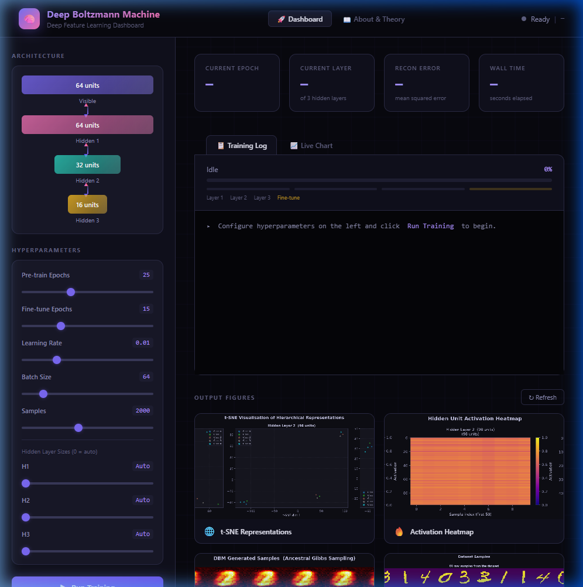
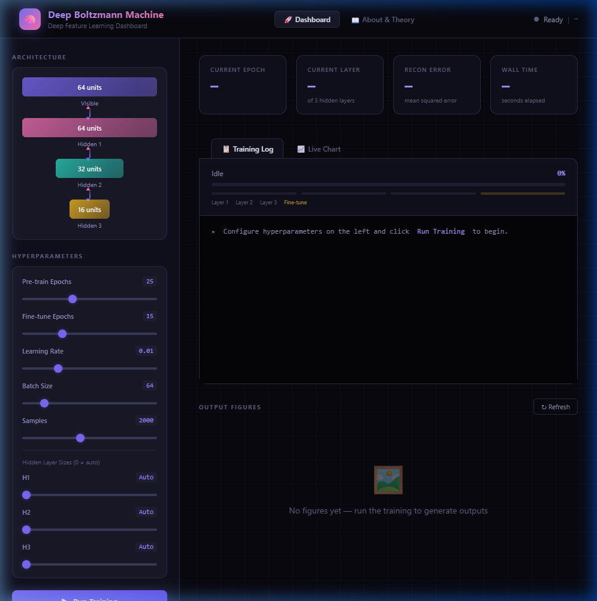
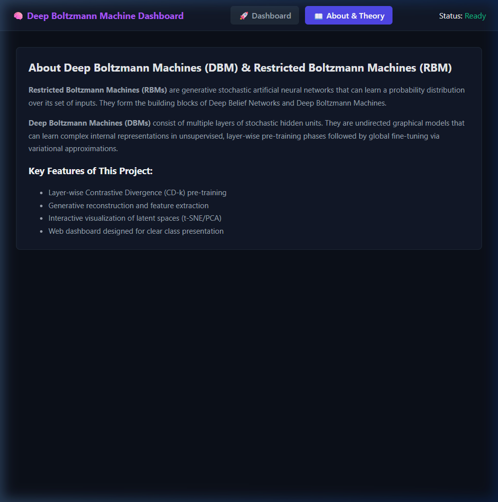
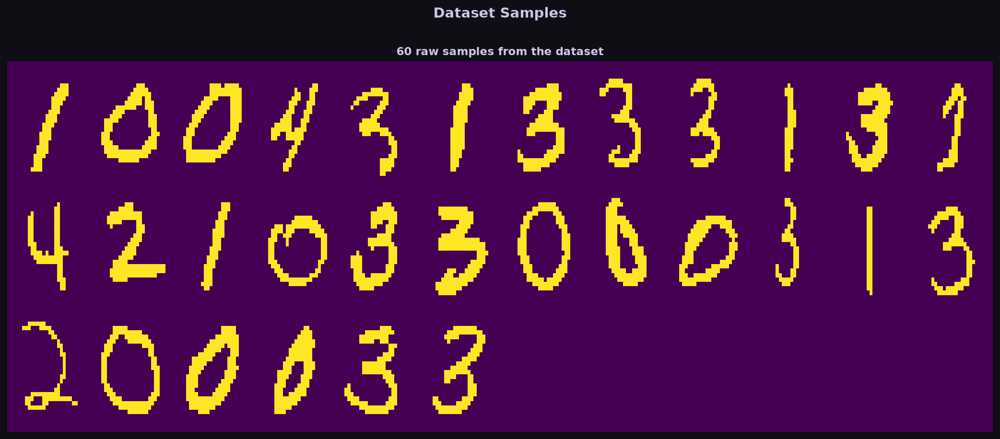
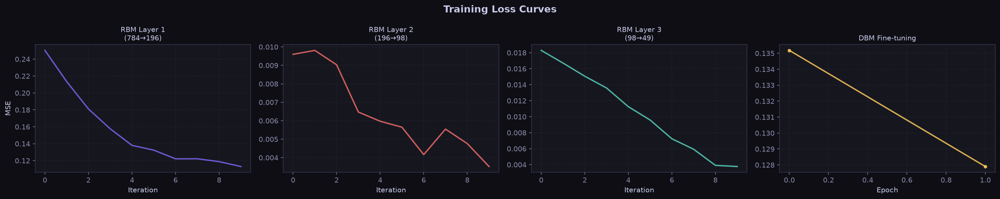
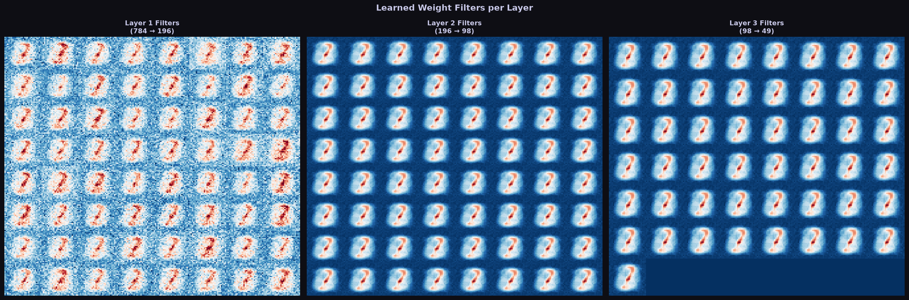
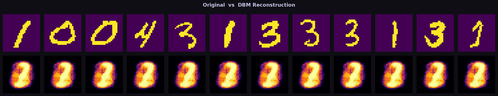
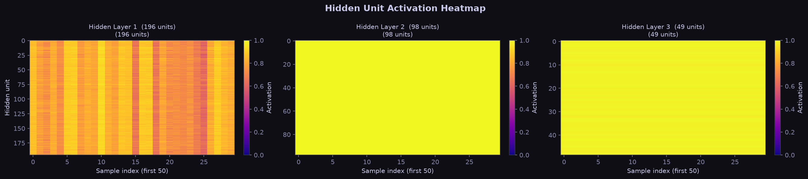
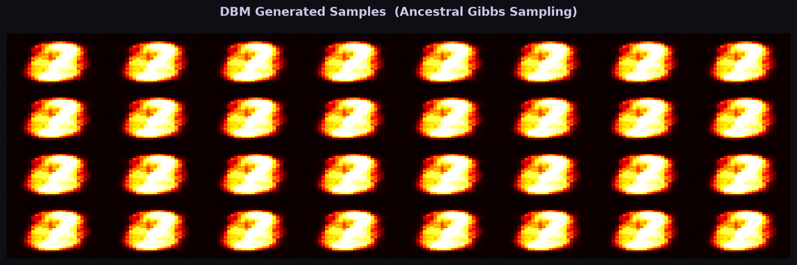
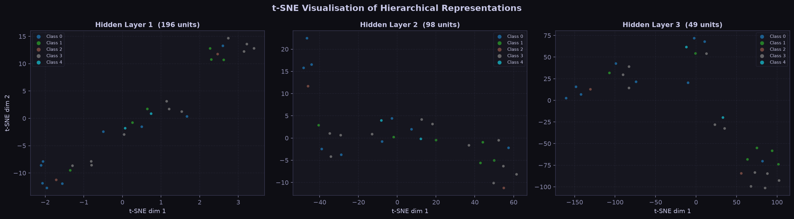

# Deep Boltzmann Machine (DBM) — Feature Learning & Interactive Analytics Dashboard

[](https://www.python.org/)
[](https://flask.palletsprojects.com/)
[](LICENSE)
[](https://en.wikipedia.org/wiki/Boltzmann_machine)
[](https://pytorch.org/)

An end-to-end, production-ready implementation of a **Deep Boltzmann Machine (DBM)** with greedy layer-wise Restricted Boltzmann Machine (RBM) pre-training, Persistent Contrastive Divergence (PCD) fine-tuning, Gibbs sampling, and an **interactive, modern web dashboard** for real-time monitoring, live training execution, and visual analytics.

---

## 📸 Interactive Web Dashboard in Action

The project includes a built-in Flask web dashboard featuring a dark glassmorphic UI, real-time hyperparameter configuration, live streaming execution logs, and an integrated visual results gallery.

### 1. Live Training Execution & Dynamic Output Gallery
The dashboard provides a unified view showing model architecture, active hyperparameters, real-time training progress with streaming logs, and immediate display of generated evaluation cards:


### 2. Control Center & Hyperparameter Tuning
Easily configure pre-training epochs, fine-tuning epochs, learning rates, batch sizes, sample counts, and custom hidden layer dimensions:


### 3. Model Theory & Mathematical Formulation Panel
An in-app theoretical reference detailing the probabilistic graphical foundations, energy formulations, and inference algorithms:


---

## 🌟 Key Features

- **Deep Energy-Based Model**: Full multi-layer undirected probabilistic graphical model ($v \leftrightarrow h_1 \leftrightarrow h_2 \leftrightarrow h_3$) with symmetric bipartite connections.
- **Greedy Layer-Wise Pretraining**: Overcomes deep vanishing gradient and local minima barriers by pre-training stacked RBMs using Contrastive Divergence ($CD_k$).
- **Joint Variational Mean-Field Fine-Tuning**: Positive phase computed via variational mean-field fixed-point iterations, paired with Persistent Contrastive Divergence ($PCD$) in the negative phase.
- **Free-Running Gibbs Dreaming**: Unconditional stochastic sampling to produce fantasy digits directly from random noise states.
- **Modern Interactive Dashboard**: Zero external CDN dependencies (100% offline capable), server-sent event (SSE) log streaming, canvas-drawn training curves, and lightbox zoom for all figures.
- **Robust 3-Tier Data Pipeline**: Seamless fallback from Torchvision MNIST $\to$ Scikit-Learn OpenML $\to$ High-Entropy Synthetic Digits, ensuring zero runtime crashes regardless of network or local environment.
- **7 Publication-Grade Visualizations**: Matplotlib plots covering receptive field weight filters, t-SNE representation clusters, activation heatmaps, and reconstruction comparisons.

---

## 🧠 Model Architecture & Mathematical Formulation

Unlike Deep Belief Networks (DBNs) which are directed generative models with undirected top layers, a **Deep Boltzmann Machine (DBM)** features **undirected symmetric connections between all adjacent layers**. This enables bidirectional information flow: top-down feedback refines lower-level representations, while bottom-up signals drive higher-level feature abstraction.

```text
    ┌──────────────────────────────────────────────┐
    │          Layer 3: Hidden Units (h3)          │   e.g., 16 units
    └──────────────────────┬───────────────────────┘
                           │ ▲  W3 (Undirected)
                           ▼ │
    ┌──────────────────────────────────────────────┐
    │          Layer 2: Hidden Units (h2)          │   e.g., 32 units
    └──────────────────────┬───────────────────────┘
                           │ ▲  W2 (Undirected)
                           ▼ │
    ┌──────────────────────────────────────────────┐
    │          Layer 1: Hidden Units (h1)          │   e.g., 64 units
    └──────────────────────┬───────────────────────┘
                           │ ▲  W1 (Undirected)
                           ▼ │
    ┌──────────────────────────────────────────────┐
    │          Layer 0: Visible Units (v)          │   e.g., 784 units (28×28 pixels)
    └──────────────────────────────────────────────┘
```

### 1. Joint Energy Function
The energy of a state configuration $(v, h_1, h_2, h_3)$ is defined as:

$$E(v, h_1, h_2, h_3) = - v^T W_1 h_1 - h_1^T W_2 h_2 - h_2^T W_3 h_3 - b^T v - c_1^T h_1 - c_2^T h_2 - c_3^T h_3$$

Where:
- $v \in \{0, 1\}^D$: Visible layer binary units
- $h_l \in \{0, 1\}^{H_l}$: Stochastic binary units at hidden layer $l$
- $W_l$: Weight matrices connecting layer $l-1$ and layer $l$
- $b, c_l$: Bias vectors for visible and hidden layers

The joint probability distribution over all units is governed by the Boltzmann distribution:

$$P(v, h_1, h_2, h_3) = \frac{1}{Z} \exp\left(-E(v, h_1, h_2, h_3)\right), \quad Z = \sum_{v, h_1, h_2, h_3} \exp\left(-E(v, h_1, h_2, h_3)\right)$$

### 2. Positive Phase: Variational Mean-Field Inference
Because hidden layers are coupled in a DBM, conditioning on $v$ does not yield mutually independent hidden states. We approximate the true posterior $P(h \mid v)$ with a fully factorized variational distribution $Q(h \mid v) = \prod_i q(h_i)$, solved through iterative fixed-point mean-field updates:

$$\mu_1 \leftarrow \sigma\left( v W_1 + \mu_2 W_2^T + c_1 \right)$$

$$\mu_2 \leftarrow \sigma\left( \mu_1 W_2 + \mu_3 W_3^T + c_2 \right)$$

$$\mu_3 \leftarrow \sigma\left( \mu_2 W_3 + c_3 \right)$$

Where $\sigma(z) = \frac{1}{1 + e^{-z}}$ is the sigmoid activation function, and $\mu_l$ denotes the expected activation (mean field) of layer $l$.

### 3. Negative Phase: Persistent Contrastive Divergence (PCD)
To approximate expectations under the model distribution without waiting for MCMC chains to burn in at each parameter update, persistent Gibbs chains maintain state across mini-batches:

$$v_{neg}, h_{neg} \sim \text{GibbsStep}(v_{persistent}, h_{persistent})$$

Parameter gradients are computed as the difference between data-dependent and model expectations:

$$\Delta W_l = \eta \left( \mathbb{E}_{data}[\mu_{l-1}^T \mu_l] - \mathbb{E}_{model}[h_{l-1, neg}^T h_{l, neg}] \right) - \lambda W_l$$

---

## 📊 Experimental Results & Diagnostic Gallery

During model execution, the pipeline automatically generates 7 evaluation figures saved directly to the root directory and served in the web gallery:

| Figure | Description | Purpose |
| :--- | :--- | :--- |
| **`fig_dataset_samples.png`** | Binarized $28 \times 28$ input samples from the training set | Data verification |
| **`fig_training_curves.png`** | Reconstruction error across epochs for RBMs and joint DBM | Convergence diagnostics |
| **`fig_weight_filters.png`** | First-layer weight filters ($W_1$) visualized as 2D receptive fields | Feature detector analysis |
| **`fig_reconstructions.png`** | Side-by-side original inputs vs. DBM reconstructed digits | Reconstruction fidelity |
| **`fig_activation_heatmap.png`** | Hidden layer unit activation sparsity across validation samples | Latent representation sparsity |
| **`fig_generated_samples.png`** | Ancestral Gibbs sampling fantasy digits drawn from noise | Generative capacity |
| **`fig_tsne_representations.png`** | 2D t-SNE projection of learned hidden representations | Latent manifold clustering |

---

### Detailed Visual Analysis

#### 1. Input Dataset Samples
Input digits normalized and binarized for stochastic binary visible unit processing:


#### 2. Training Convergence Curves
Loss trajectories showing smooth decrease during greedy pre-training (RBM1, RBM2, RBM3) followed by global refinement in PCD fine-tuning:


#### 3. Learned Weight Filters (Receptive Fields)
First-layer weights $W_1$ projected into $28 \times 28$ pixel space. The model automatically learns localized edge detectors, pen-stroke filters, and loop detectors without supervision:


#### 4. Reconstruction Quality
Test digits passed through the full encoder-decoder Gibbs cycle ($v \to h_1 \to v'$). Notice the clear reconstruction of canonical digit shapes:


#### 5. Hidden Layer Activation Heatmaps
Activation distributions across validation samples, demonstrating distributed, sparse representations without dead neurons:


#### 6. Free-Running Generative Samples (Gibbs Fantasy)
Samples generated by initializing the visible units with uniform random noise and running alternating Gibbs sampling for 500 steps:


#### 7. t-SNE Clustering of Latent Representations
2D t-SNE manifold projections of the deepest hidden representations. Digits of the same class naturally cluster together in latent space without ever seeing digit labels:


---

## 📁 Repository Structure

```text
deep-boltzmann-machine/
├── app.py                      # Flask web server: REST API, SSE streaming & UI routes
├── dbm.py                      # Deep Boltzmann Machine joint model (Mean-Field + PCD)
├── rbm.py                      # Restricted Boltzmann Machine building blocks (CD-k + Momentum)
├── train.py                    # Complete end-to-end training & evaluation pipeline
├── visualize.py                # Publication-grade plotting suite (dark aesthetic)
├── requirements.txt            # Python dependencies
├── .gitignore                  # Git ignore rules for cached datasets and virtualenvs
├── LICENSE                     # MIT License
├── templates/
│   └── index.html              # Responsive dark-mode dashboard (Zero external CDN)
└── assets/
    ├── screenshots/            # Dashboard UI and execution screenshots
    │   ├── dashboard_live_output.png
    │   ├── dashboard_overview.png
    │   ├── training_progress.png
    │   ├── dashboard_gallery.png
    │   └── model_theory.png
    └── results/                # High-resolution output figures
        ├── fig_dataset_samples.png
        ├── fig_training_curves.png
        ├── fig_weight_filters.png
        ├── fig_reconstructions.png
        ├── fig_activation_heatmap.png
        ├── fig_generated_samples.png
        └── fig_tsne_representations.png
```

---

## 🚀 Quickstart Guide

### 1. Clone the Repository
```bash
git clone https://github.com/SanjayNalagatla/deep-boltzmann-machine.git
cd deep-boltzmann-machine
```

### 2. Set Up Virtual Environment & Install Dependencies
```bash
# Create virtual environment
python -m venv venv

# Activate virtual environment
# Windows:
.\venv\Scripts\activate
# macOS/Linux:
source venv/bin/activate

# Install dependencies
pip install -r requirements.txt
```

### 3. Launch the Interactive Web Dashboard
```bash
python app.py
```
Open your browser and navigate to:
```
http://127.0.0.1:5000
```
- Click **▶ Run Training** to start training with live streaming terminal logs.
- Adjust sliders in real time for quick experiments or deep training runs.
- Click any figure card in the gallery to open a high-resolution lightbox view.

### 4. Or Run via Command Line Interface (CLI)
```bash
python train.py
```
You can also override hyperparameters directly via environment variables:
```bash
# Windows PowerShell:
$env:DBM_PRETRAIN_EPOCHS="15"; $env:DBM_FINETUNE_EPOCHS="10"; $env:DBM_N_SAMPLES="1000"; python train.py

# Linux / macOS:
DBM_PRETRAIN_EPOCHS=15 DBM_FINETUNE_EPOCHS=10 DBM_N_SAMPLES=1000 python train.py
```

---

## 🛠️ Technical Stack & Implementation Details

- **Deep Learning / Core Math**: NumPy, PyTorch (for tensor utilities and fast data batching)
- **Dimensionality Reduction**: Scikit-Learn (`TSNE` manifold estimation)
- **Visual Analytics**: Matplotlib (custom dark theme with high DPI outputs)
- **Web Backend**: Flask (Server-Sent Events streaming, REST API, non-blocking subprocess management)
- **Web Frontend**: Modern Vanilla HTML5 / CSS3 / JavaScript (Glassmorphic cards, CSS grid, SVG icons, zero CDN dependencies)

---

## 📜 Academic References

1. **Salakhutdinov, R., & Hinton, G.** (2009). *Deep Boltzmann Machines*. In Proceedings of the 12th International Conference on Artificial Intelligence and Statistics (AISTATS).
2. **Hinton, G. E.** (2002). *Training Products of Experts by Minimizing Contrastive Divergence*. Neural Computation, 14(8), 1771-1800.
3. **Hinton, G. E.** (2012). *A Practical Guide to Training Restricted Boltzmann Machines*. Neural Networks: Tricks of the Trade, Springer.
4. **Tieleman, T.** (2008). *Training Restricted Boltzmann Machines using Approximations to the Likelihood Gradient*. In Proceedings of the 25th International Conference on Machine Learning (ICML).

---

## 📄 License
This project is open-source and distributed under the [MIT License](LICENSE).
